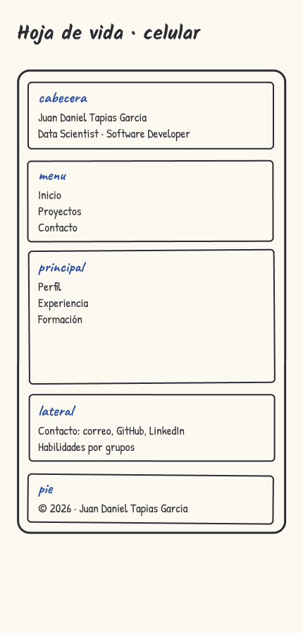
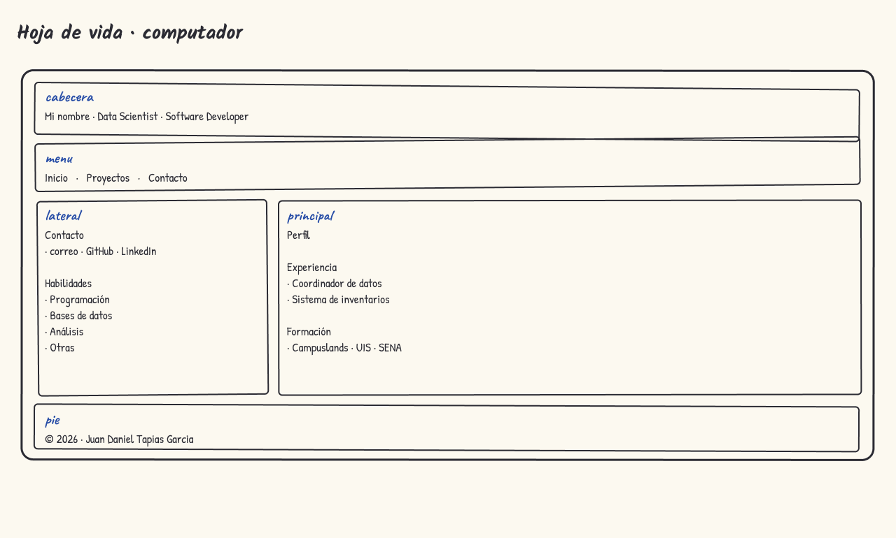
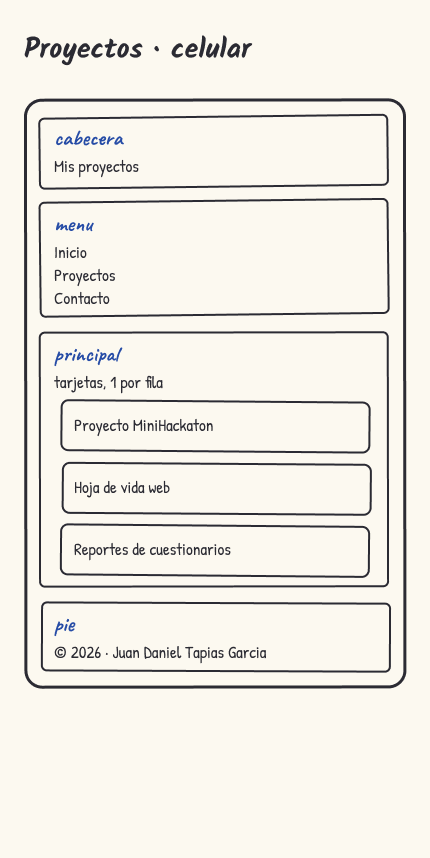
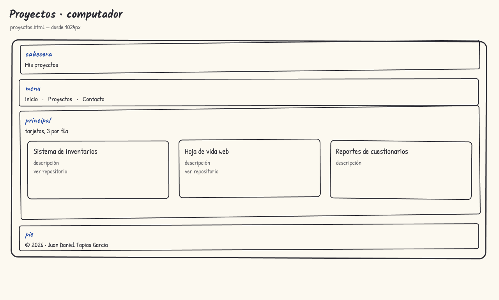
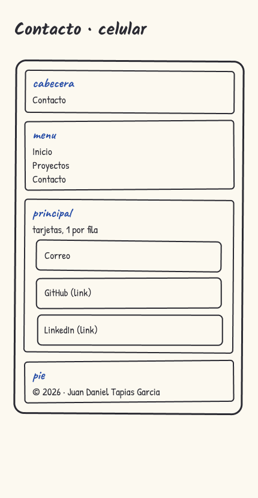
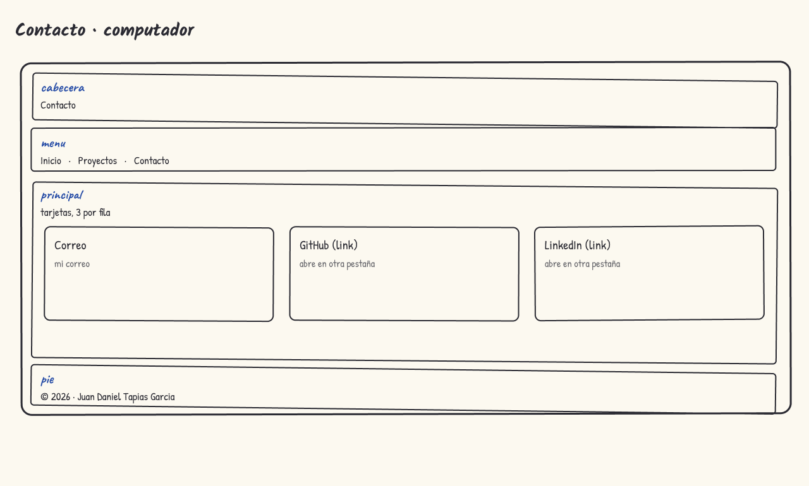
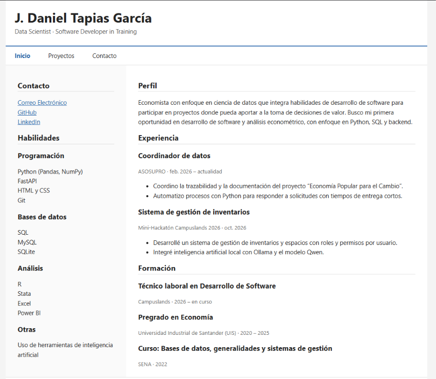

# Hoja de vida web · J. Daniel Tapias García

Sitio personal con mi hoja de vida en estilo ATS (sobrio y fácil de leer), mis proyectos y mis datos de contacto. Está construido con HTML y CSS, con diseño Mobile First y CSS Grid.

**Sitio publicado:** https://judatasgar.github.io/ATS_CV_JDTG/

## Páginas
- `index.html`: hoja de vida (perfil, experiencia, formación y habilidades)
- `proyectos.html`: proyectos en tarjetas
- `contacto.html`: correo, GitHub y LinkedIn

## Mockups
### Hoja de vida

### Proyectos

### Contacto

## Capturas del sitio publicado

## Breakpoints
- **Base (celular):** todo va en una sola columna, en el orden en que quiero que se lea la hoja de vida. El menú queda debajo de la cabecera, con un enlace por línea.
- **Desde 600px:** el menú pasa a una fila horizontal y el nombre se ve más grande. Las tarjetas se acomodan de a 2 cuando hay espacio.
- **Desde 1024px:** en la hoja de vida aparece una columna lateral a la izquierda con contacto y habilidades, y el contenido principal queda a la derecha. Las tarjetas se acomodan de a 3.

## Fuentes consultadas
- Documentación de GitHub Pages: https://docs.github.com/es/pages/getting-started-with-github-pages
- Material de clase de Campuslands sobre CSS Grid, media queries y diseño responsive.
